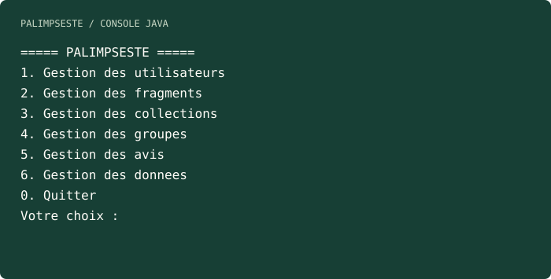

# Le Dernier des Palimpsestes

A Java console application for collecting text fragments, organising personal collections and requesting feedback from users or groups. Academic project focused on object-oriented programming and file persistence.

[Français](README.md) · [Portfolio](https://portfolio.jobandjudith.com/en/) · [Separate SQL project](https://github.com/erebethos/palimpseste-bdd)



## What works

- Four fragment types: quotations, reading notes, personal thoughts and web excerpts.
- Users, collections, themes, keywords, favourites and archiving modes.
- Groups, group membership, feedback requests and responses.
- Demo data and saving/loading the application state through Java serialisation.

## Run locally

Use **JDK 21** and a POSIX shell (Linux, macOS or Git Bash). No external Java libraries are needed. The build targets Java 20, matching the NetBeans project configuration.

```sh
git clone https://github.com/erebethos/le-dernier-des-palimpsestes.git
cd le-dernier-des-palimpsestes
sh scripts/build.sh
java -jar dist/le_dernier_des_palimpsestes.jar
```

Alternatively, open the root project in NetBeans, select a suitable JDK, then build and run. `nbproject/` and the Ant build files are retained; private IDE settings and generated binaries are not tracked.

## Try the demo

1. Choose **6 — Gestion des donnees**.
2. Choose **4 — Initialiser des donnees de test**, once in a fresh session.
3. Choose **1 — Afficher toutes les donnees** to inspect the sample objects.
4. Return with **0**, then explore users, fragments, collections and feedback.
5. Quit with **0** from the main menu; restart to reload the saved state.

The application stores `palimpseste.dat` in the Java user's home directory. For an isolated demo, create an empty folder and run `java -Duser.home=/absolute/path/to/demo -jar dist/le_dernier_des_palimpsestes.jar`. Use a new folder for a fresh session. The menus remain in French.

## Structure and checks

| Directory | Role |
|---|---|
| `src/classes/` | Domain objects, fragment inheritance and enums |
| `src/listes/` | In-memory collections and operations |
| `src/menus/` | Console interaction |
| `src/data/` | Application state, demo data and persistence |
| `src/outils/` | Input utilities |
| `tests/` | Isolated save/load regression check |

```sh
sh scripts/test.sh
```

This check compiles from source, saves a user and a fragment in a temporary home directory, then verifies that they can be reloaded.

## Scope and next steps

This is a local, single-process console application. Users are domain objects, not authenticated accounts. Persistence uses a file, **not** a database; the SQL project is a separate implementation of the same domain. Automatic resurfacing is not a background service in this application.

Further work: broader input and domain tests, clearer load-error reporting, and a storage interface that could support a future database implementation.

Author: [François de Gennaro](https://portfolio.jobandjudith.com/en/).
